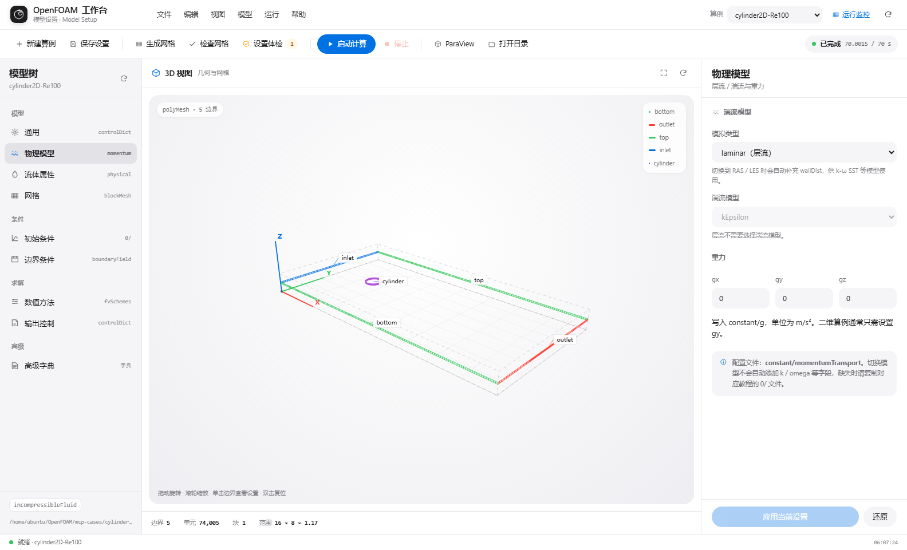
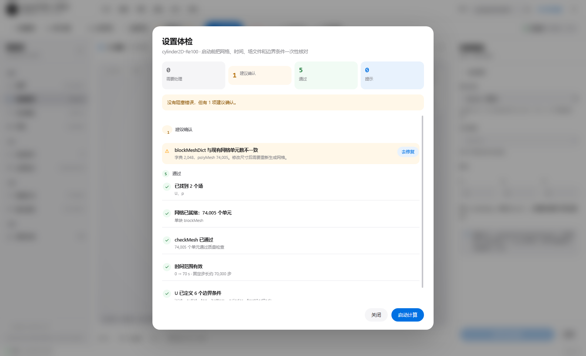
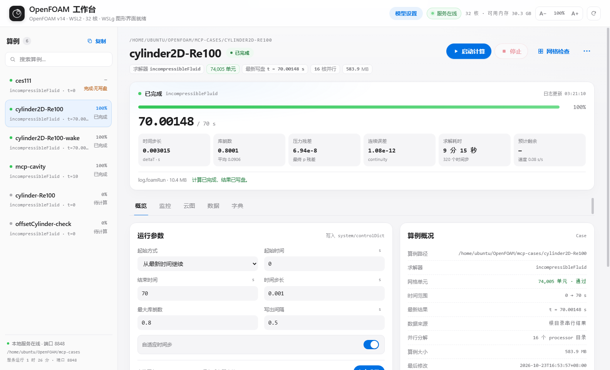
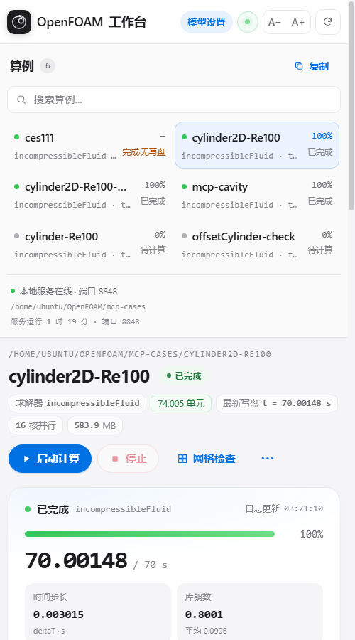

# OpenFOAM 14 Web 工作台

一个跑在 WSL2 里的本地 OpenFOAM 前处理与运行监控界面。界面参考 Flow-3D 的任务式布局，并针对它弹窗层级深、错误提示绕、状态不透明等问题做了简化。

- **模型设置**：Flow-3D 风格三栏布局，模型树 + 可交互 3D 网格 + 属性面板
- **运行监控**：算例列表、进度、残差、日志、云图、力系数与字典编辑
- **无需前端构建**：Python 标准库 HTTP 服务 + 原生 JavaScript / Canvas
- **默认中文界面**：OpenFOAM 字典关键字保持英文

> 这是一个面向单用户的本地工具，没有登录和权限系统。不要把 8848 端口直接暴露到公网。

## 截图

### 模型设置



三栏布局：左侧模型树，中间 3D 网格视图，右侧属性面板。单击 3D 边界或图例可直接打开对应 patch 的边界条件。

### 运行前设置体检



集中核对网格、`checkMesh`、时间范围、写出间隔、湍流场、边界覆盖和未应用修改。错误会阻止启动，并可一键跳到对应面板修复。

### 运行监控



浅色仪表盘，概览 / 监控 / 云图 / 数据 / 字典五个标签。右上角 A− / A+ 可在 15–22 px 间调整整页字号，图表刻度同步缩放，选择会保存在 `localStorage`。

### 窄屏



980 px 以下侧栏算例改为两列；620 px 以下压缩顶栏，但保留算例切换、服务状态、字号和刷新。

更多截图见 [`screenshots/`](screenshots/)。

## 功能

### 模型设置

- 通用：求解器、起止时间、时间步长、库朗数、自适应步长、写出控制
- 物理模型：层流 / RAS / LES 与湍流模型
- 流体属性：输运属性与状态方程
- 网格：`blockMesh` 参数、网格统计、生成与检查网格
- 初始条件：`0/` 下的场文件
- 边界条件：按 patch 设置类型与参数
- 数值方法：`fvSchemes`、`fvSolution`
- 输出控制：写出格式、间隔、函数对象（`forceCoeffs`）
- 高级字典：直接编辑 `system/`、`constant/`、`0/` 下的文件

### 设置体检

启动前一次性检查：

- `polyMesh` 是否存在，`checkMesh` 是否通过
- 起止时间、时间步长、自适应步长与最大库朗数是否自洽
- `writeInterval` 是否会在结束前写盘
- 湍流模型需要的场文件是否齐全
- `U` 边界是否覆盖入口 / 出口等 patch
- 是否有未应用的修改、算例是否正在运行

结果按“需要处理 / 建议确认 / 通过 / 提示”分组。红色错误会阻止启动；黄色警告不阻止启动，但会在启动前再提醒一次。

### 3D 边界点选与未保存保护

- 单击 3D 网格边界或右上角图例，直接进入对应 patch 的边界设置。
- 左键拖动旋转、滚轮缩放、双击复位；拖动与点击有阈值区分。
- 修改输入后出现“未应用”标记，应用按钮才启用；离开页面会触发浏览器提醒，也可一键还原。
- 运行中的算例会锁定设置。

### 运行监控

- 进度与时间、时间步长、库朗数、残差、耗时与预计剩余
- 残差曲线，支持实时刷新
- 调用 ParaView 渲染云图，保留历史图库并支持下载
- 读取 `forceCoeffs` 的 Cd / Cl 数据
- 直接编辑字典，保存时自动生成 `.bak` 备份
- 区分“已完成”和“完成·无写盘”：如果 `writeInterval` 大于结束时间，磁盘上可能只有 `0/`，界面会明确提示，避免误报结果已写盘

## 环境

在以下环境验证：

| 组件 | 版本 |
| --- | --- |
| Windows | Windows 11 + WSL2 |
| Linux | Ubuntu 24.04 LTS（WSL 发行版名 `OpenFOAM-Ubuntu`） |
| OpenFOAM | 14（`/opt/openfoam14`） |
| Python | 3.12（仅标准库） |
| ParaView | 5.11.2（云图渲染可选） |
| 浏览器 | Chrome / Edge |

## 快速开始

### 1. 放置文件

默认布局：

```text
/home/<user>/OpenFOAM/gui/
├── openfoam_gui.py
├── model_api.py
├── _pv_render.py
└── static/
    ├── index.html
    ├── app.js
    ├── app.css
    ├── model.html
    ├── model.js
    └── model.css
```

算例目录默认是 `/home/<user>/OpenFOAM/mcp-cases`。

### 2. 修改路径

`openfoam_gui.py` 顶部集中定义了环境路径：

```python
BASE = Path("/home/ubuntu/OpenFOAM/mcp-cases")   # 算例根目录
GUI_DIR = Path("/home/ubuntu/OpenFOAM/gui")      # 本目录
FOAM_BASHRC = "/opt/openfoam14/etc/bashrc"
PVPYTHON = "/usr/bin/pvpython"
HOST, PORT = "0.0.0.0", 8848
```

如果用户名或安装路径不同，修改这里。`model_api.py` 里的教程路径 `/opt/openfoam14/tutorials` 也需要按需调整。

### 3. 启动

```bash
cd /home/<user>/OpenFOAM/gui
python3 openfoam_gui.py
```

浏览器打开 `http://<WSL-IP>:8848/model`。WSL IP 可用 `hostname -I` 查看。

### 4. systemd（可选）

仓库提供 [`deploy/openfoam-gui.service`](deploy/openfoam-gui.service) 作为示例。按实际用户名和路径修改后：

```bash
sudo cp deploy/openfoam-gui.service /etc/systemd/system/
sudo systemctl daemon-reload
sudo systemctl enable --now openfoam-gui
```

查看状态：

```bash
systemctl status openfoam-gui
```

## 目录结构

```text
.
├── openfoam_gui.py          # HTTP 服务、运行监控与任务 API
├── model_api.py             # 字典解析/写入、网格读取、算例创建
├── _pv_render.py            # 由 pvpython 执行的 ParaView 渲染脚本
├── static/
│   ├── index.html           # 运行监控页
│   ├── app.js
│   ├── app.css
│   ├── model.html           # 模型设置页
│   ├── model.js
│   └── model.css
├── deploy/
│   └── openfoam-gui.service
└── screenshots/
```

## 实现说明

- 后端使用 `http.server.ThreadingHTTPServer`，没有第三方 Python Web 框架。
- 字典读写、网格统计、`blockMesh` / `checkMesh` / 求解器启动都通过子进程调用 OpenFOAM 工具。
- 求解日志按时间步解析，生成进度和残差曲线。
- 云图由 `pvpython _pv_render.py` 在 ParaView 中渲染，输出 PNG 并返回场范围和相机信息。
- 前端是原生 JavaScript，3D 网格用 Canvas 2D 投影绘制，没有 WebGL 或打包步骤。

## 安全与已知限制

- **没有身份验证**，服务绑定 `0.0.0.0:8848`。只应在本地或可信网络使用，不要做公网端口映射。
- 同名路径、字典写入和求解器启停都直接操作文件系统，没有多用户隔离。
- `blockMesh` 会覆盖已有网格；界面会提示，但不会替用户备份结果。
- 大网格的 `checkMesh` 和 ParaView 渲染可能耗时较长。
- 默认路径与 WSL 用户名相关，迁移到其他机器时需要改 `openfoam_gui.py` 顶部常量。
- 完成但未写盘的情况会在界面警告，但不会自动修改 `controlDict`；是否补写由用户决定。

## 验证情况

- 模型页与监控页在 1584、980、500 px 下完成截图检查；500 px 下无横向滚动。
- 五个监控标签、启动弹窗、云图灯箱、搜索、算例切换、字号加减均已操作验证。
- 未保存保护：修改字段后 `beforeunload` 被拦截，还原后解除。
- 两页交互扫描无 JavaScript `error` / `unhandledrejection`。
- 验证期间未启动或停止求解，也未保存设置修改。
